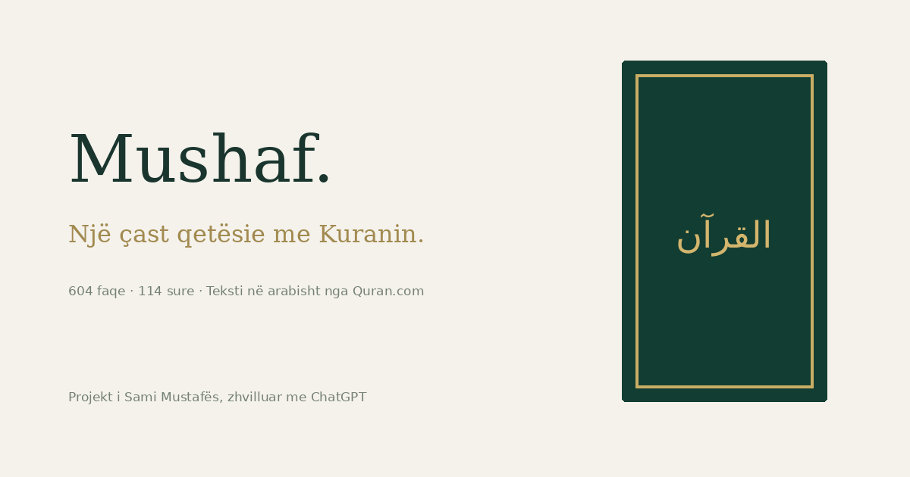

<div align="center">

# **MUSHAF**
### **A quiet place to open the Quran.**

**604 pages · 114 Surahs · 6,236 verses**

An original **emerald and gold Quran reading experience**, with a Three.js book opening, authentic Arabic text from **Quran.com**, and smooth right-to-left page turns.

**Created by Sami Mustafa · Designed and built with ChatGPT**

[**Open the live website →**](https://sami-mushaf.samimustafa072.chatgpt.site)

<a href="https://sami-mushaf.samimustafa072.chatgpt.site"></a>

**THREE.JS** &nbsp; / &nbsp; **AUTHENTIC ARABIC** &nbsp; / &nbsp; **RESPONSIVE READER**

</div>

---

## **The experience**

Open an illustrated Mushaf on its wooden stand and settle into a warm, paper-inspired reader. Read at your own pace, swipe through pages, or choose a Surah and watch the pages turn quickly toward your destination.

| **Feature** | **What it does** |
| :--- | :--- |
| **The complete Quran** | All **604 Madani pages**, **114 Surahs**, and **6,236 verses**. |
| **Authentic Arabic** | Quran.com Uthmani text, QCF V2 glyphs, and source page and line positions. |
| **An opening book** | A Three.js orthographic scene with an animated cover and original emerald and gold artwork. |
| **Smooth page turns** | Right-to-left turning, touch swipes, buttons, and keyboard controls. |
| **Fast page journeys** | Page, Surah, Juz, and bookmark selections turn through up to **eight intermediate spreads**, then ease into the exact destination. The animation takes at most **1.25 seconds**, after loading. |
| **Made for every screen** | Two-page desktop spreads and a single-page mobile reader. |
| **Find your place** | Search Surahs, browse **30 Juz**, select a page, or share a direct `#page=42` link. |
| **Make it comfortable** | Night mode, distraction-free reading, and reduced-motion support. |
| **Pick up where you stopped** | Bookmarks, reading position, and preferences saved on your device. |

**No account. No API key. No build step.** The website includes its Quran text data and Three.js modules locally.

## **Run it locally**

```sh
git clone https://github.com/samimustafaa/quran-recituesi-web.git
cd quran-recituesi-web
python -m http.server 8000 --directory dist
```

Open **[http://localhost:8000](http://localhost:8000)** in your browser. Serve the files over HTTP because the reader uses JavaScript modules and fetches local page data.

**Requirements:** Python 3 for the example server; a modern browser. Node.js is needed only for the verification script. There are no npm dependencies to install.

## **Publish your own copy**

The **`dist/` directory is the complete static website**. Deploy its contents to a static host; no build command is required. Serve it at the root of its domain because asset paths begin with `/`.

The first **32 QCF page fonts** are bundled. Fonts for pages **33–604** load on demand from a pinned revision of Quran.com's frontend repository through jsDelivr, with a GitHub fallback. Those pages need a network connection to load their exact glyph font for the first time. Reduced-motion preferences skip animated page journeys.

## **Quran text and integrity**

**The Arabic verse text is sourced, never generated or rewritten.**

The importer collects the complete Quran.com API v4 corpus, including every paginated response, full Uthmani text, QCF V2 glyphs, and word positions. The legacy page endpoint selects V1 verse ranges, so the importer reconstructs the **604 V2 pages** using each word's explicit **`v2_page`** and **`line_v2`** coordinates. Chapter ranges are rebuilt from those same positions.

The import verifies that **every verse matches Quran.com's bulk Uthmani response byte for byte**, and that each Surah contains its expected verses. The record is included in [`dist/data/provenance.json`](dist/data/provenance.json).

- **Source:** [Quran.com API v4](https://api.quran.com/api/v4)
- **Import date:** October 10, 2026
- **Corpus:** 604 pages · 114 Surahs · 6,236 verses
- **Fonts:** Quran.com QCF V2 and Uthmanic Hafs assets

The cover, borders, and stand are **original digital artwork inspired by a traditional Mushaf**. This reader follows source page boundaries and line positions; it is not a scan of a printed edition. Passing pages during fast journeys use authentic Uthmani Unicode text; the destination uses its corresponding QCF V2 font.

## **Verify the project**

```sh
npm run check
# or
node scripts/check.mjs
```

Checks cover **all 604 page files**, the complete verse set, Surah counts, word preservation, bundled font headers, heading placement, right-to-left navigation, destination accuracy, jump-animation duration, and local asset references.

## **Inside the repository**

```text
dist/
  index.html          Website entry point
  style.css           Book artwork and responsive reader styling
  app.js              Reader controls, preferences, and page journeys
  reader-core.js      Page layout and navigation helpers
  book-scene.js       Three.js opening-book scene
  data/               604 Quran pages, chapters, index, and provenance
  assets/             Original artwork, fonts, and vendored Three.js
scripts/
  import-quran.py     Quran.com data import and integrity verification
  check.mjs           Content and navigation checks
```

## **Credits & attribution**

| **Contribution** | **Credit** |
| :--- | :--- |
| **Project & original artwork** | **[Sami Mustafa](https://github.com/samimustafaa)** |
| **Design & development collaborator** | **ChatGPT / OpenAI** |
| **Quran text, glyphs & page data** | **[Quran.com / Quran Foundation](https://quran.com)** |
| **QCF V2 & Uthmanic Hafs font assets** | [Quran.com frontend repository](https://github.com/quran/quran.com-frontend-next) |
| **3D rendering** | **Three.js contributors** — MIT notice included in `dist/assets/three-LICENSE.txt` |
| **Interface & editorial typography** | **Geist and Cormorant Garamond** — SIL Open Font License notices included in `dist/assets/` |

This is an **independent project** and is not affiliated with Quran.com. Please preserve **Sami Mustafa's project credit** and all source attribution when sharing. Third-party assets remain subject to their own licenses and terms.

---

<div align="center">

**Built with care by Sami Mustafa, together with ChatGPT.**

[**Read the Quran →**](https://sami-mushaf.samimustafa072.chatgpt.site)

</div>
